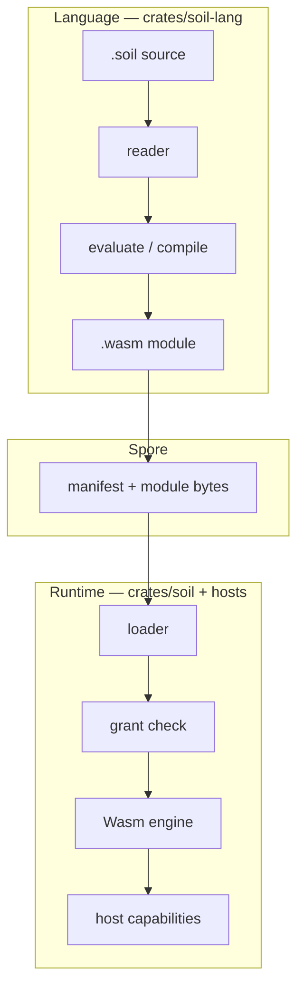

# LOAM

Soil is two layers:

- **Language** — `crates/soil-lang`. Reads `.soil` source, evaluates or compiles
  it, ships the stdlib, and emits WebAssembly.
- **Runtime** — `crates/soil` and the host crates. Loads a Spore, checks its
  manifest, runs the Wasm module, and owns the capabilities.

The language is how you write the program. The runtime is what gives it
permission to do anything. A `.soil` file never opens a socket or reads a
device; a Wasm module can only call imports the host grants. A Spore is the
packaging unit between them: a manifest plus module bytes.

The runtime does not parse Soil, and the language does not own a network stack.
A Spore can be written in another language and still run; the host only sees the
manifest, the module, and the imports it is allowed to link.

## Capability contracts

| Package | Grant | Status |
|---|---|---|
| [`soil:principal@0.1.0`](wit/soil-principal.wit) | `soil:principal` | host-attested Mycelium/OIDC projection; actor, device, teams, roles |
| [`soil:view@1.0.0`](wit/soil-view.wit) | `soil:view`, optional `soil:view.capture` | WIT; host pending |
| [`soil:time@1.1.0`](wit/soil-time.wit) | `soil:time` | WIT + monotonic/wall clocks and host ticks |
| [`soil:storage@1.0.0`](wit/soil-storage.wit) | `soil:storage.read`, optional `soil:storage.write` | WIT; host pending |
| [`soil:appdata@1.0.0`](wit/soil-appdata.wit) | `soil:appdata` | WIT + guest SDK + records-backed host |
| [`soil:records@0.1.0`](wit/soil-records.wit) | `soil:records` read/write/sync | WIT + generic/contacts host + guest SDK |
| [`soil:http@0.1.0`](wit/soil-http.wit) | `soil:http` | WIT + bounded host + direct transport proof |
| [`soil:index@1.1.0`](wit/soil-index.wit) | `soil:index` | derived browse/search + explicit KNN; fast direct-child traversal |
| [`soil:vfs@1.0.0`](wit/soil-vfs.wit) | `soil:vfs` | read-only workspace namespace |
| [`soil:streams@0.1.0`](wit/soil-stream.wit) | `soil:stream` | host-issued WSS/Iroh/pipe byte sessions; `accept` is a poll, `read` is bounded |
| [`soil:vfs-mut@0.1.0`](wit/soil-vfs-mut.wit) | `soil:vfs-mut` | separate write/mkdir/rmdir/rename grant; streaming writer for uploads |
| [`soil:vfs-cid@0.1.0`](wit/soil-vfs-cid.wit) | `soil:vfs-cid` | content-id lookup inside the workspace namespace |
| [`soil:git@0.1.0`](wit/soil-git.wit) | `soil:git` | repository status for a granted workspace path |
| [`soil:creds@1.0.0`](wit/soil-creds.wit) | `soil:creds` | host-held signing and verification; no secret export |
| [`soil:unibus@0.1.0`](wit/soil-unibus.wit) | `soil:unibus` observe/publish | bounded poll/publish over the host-owned bus |
| [`soil:media@0.1.0`](wit/soil-media.wit) | `soil:media`, optional `soil:media-encoded` | host playback, encoded chunks, bounded image readback |
| [`soil:surface-import@0.1.0`](wit/soil-surface-import.wit) | `soil:surface-import` | host-owned imported surfaces, damage events, normalized input |
| [`soil:inference@0.3.0`](wit/soil-inference.wit) | `soil:inference` | WIT + models, tools, completion, embeddings, SSE stream resource |
| [`soil:search@0.6.0`](wit/soil-search.wit) | `soil:search` | WIT + files/records/graph host composition + host-local application inventory + typed `@` mention resolver |
| [`soil:spore@0.3.0`](wit/soil-spore.wit) | `soil:spore.catalog`, `soil:spore.launch` | installed-Spore catalog and host-owned launch; listing, running and install are separate intents |
| [`soil:graph@0.1.0`](wit/soil-graph.wit) | `soil:graph` | read-only edge/reference queries over records |
| [`soil:input@1.0.0`](wit/soil-input.wit) | — | shared normalized input types for Canvas, Terminal and imported surfaces |
| [`soil:notify@1.1.0`](wit/soil-notify.wit) | `soil:notify`, `soil:notify/ringer` | WIT + host broker + notify Spore; ringer is an interface, not a package |
| [`soil:agents@0.1.0`](wit/soil-agents.wit) | `soil:agents.observe`, `soil:agents.control` | WIT + fixture host; adapters next |
| [`fungos:actions@1.0.0`](wit/fungos-actions.wit) | exact action id/version grants | granted catalog + bounded invoke; Canvas uses the catalog projection |
| [`soil:device@0.1.0`](wit/soil-device.wit) | `soil:device` | semantic battery/estimate/lid contracts; runtime uses core-Wasm lowering |
| [`soil:ble@1.2.0`](wit/soil-ble.wit) | `soil:ble.observe`, `soil:ble.connect`, `soil:ble.write` | WIT + host + COLMI ring Spore |
| [`soil:canvas@1.0.0`](wit/soil-canvas.wit) | `soil:canvas` | WIT + input normalizer + S22 runtime + Android JNI |
| [`soil:scene@1.0.0`](wit/soil-scene.wit) | link `soil:scene` | scene payload negotiation: `supports` and `budget` |
| [`soil:present@0.1.0`](wit/soil-present.wit) | link `soil:present` | texture/RGBA delivery for component and core-Wasm guests |
| [`soil:terminal@0.1.0`](wit/soil-terminal.wit) | `soil:terminal` | host-rendered terminal surface; `terminal-host` |
| [`soil:terminal-screen@0.1.0`](wit/soil-terminal-screen.wit) | `soil:terminal-screen` | bounded live terminal grid; the host owns the pty |
| [`soil:desktops@0.1.0`](wit/soil-desktops.wit) | `soil:desktops` | which Desktops a window may bind to; no host paths |
| [`soil:worktrees@0.1.0`](wit/soil-worktrees.wit) | `soil:worktrees` | checkouts a Desktop knows; read-only rows |
| [`soil:metrics@0.1.0`](wit/soil-metrics.wit) | `soil:metrics` | one host registry per Spore, rendered as Prometheus text |
| [`soil:net@0.1.0`](wit/soil-net.wit) | `soil:net` | bounded name resolution and TCP reachability |
| [`soil:mycelium@0.1.0`](wit/soil-mycelium.wit) | `soil:mycelium` | directory and host-owned SSH/PTY session |
| [`fungos:mycelium@0.1.0`](wit/fungos-mycelium.wit) | `fungos:mycelium.pulse` | Pulse control-plane bridge to myceliumd; host pending |
| [`fungos:http-context@0.1.0`](wit/fungos-http-context.wit) | link `fungos:http-context` | host-attested invocation context for `wasi:http` handlers |
| [`fungos:webhooks@0.1.0`](wit/fungos-webhooks.wit) | `fungos:webhooks.admin` | hook administration; the secret crosses the boundary once |
| [`fungos:terminal-spore@0.1.0`](wit/terminal-spore.wit) | — | host world for the terminal Spore |
| [`wasi:webgpu@0.3.0-rc.2`](wit/deps/wasi-webgpu-0.3.0-rc.2/package.wit) | link `wasi:webgpu` | upstream WIT + host + compute fixture |
| [`wasi:audio@0.1.0`](wit/wasi-audio.wit) | link `wasi:audio` | draft WIT + cpal host + tone fixture |

`cargo test -p soil-abi` parses every canonical package and asserts its reviewed
name, interface and functions, so an accidental ABI change fails the build. See
[`wit/README.md`](wit/README.md) for the canonical/contract/deferred split.

Battery, estimate, lid and Canvas animation are semantic WIT but are lowered
through a bounded core-Wasm ABI by the S22 runtime. See
[`docs/abi-core-wasm.md`](docs/abi-core-wasm.md).
