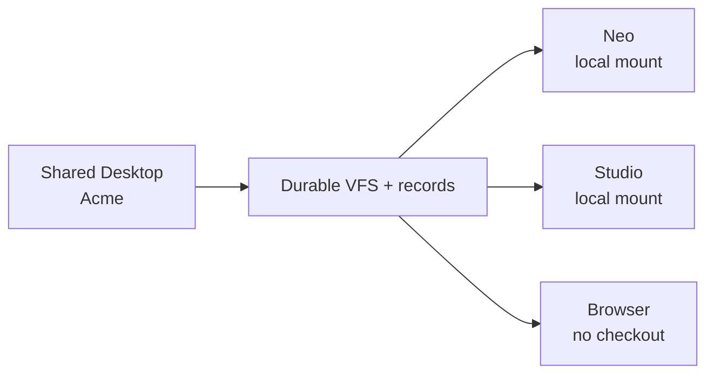

# Desktops

Status: **design, 2026-11-07.** This note fixes the vocabulary and the
boundary between a Desktop, a Project, a Thread, a Worktree, a Checkout, and
the runtime session that Mush uses.

## Definition

A **Desktop** is a durable, synced top-level namespace for one major context of
work.

A **Shared Desktop** is a Desktop with more than one principal.

Examples:

```text
Personal Desktop
FPL Desktop
Elmers Desktop
Acme Desktop
```

A Desktop is the user's "shared home" for a body of work, but it is not a POSIX
home directory and it is not a host folder. It is a capability-scoped VFS
namespace plus the records, projects, Canvas views, and grants attached to it.

A Desktop follows the principal across machines. Its **local materialization**
does not: each machine gets its own mount root and checkouts.

## The hierarchy

```text
Desktop
  Project                 named set of pinned repositories
    Thread                agent session + its per-repo worktrees
      Mount root          the thread's VFS/checkout root
        repo A worktree
        repo B worktree
      Image               live runtime attached to the mount root
```

The short form:

```text
Desktop -> Project -> Thread -> Mount root -> Image
```

`Workspace` is not a durable layer. If the word is used at all, it means one
thread's mount root, or the local session context around it. It is not a synonym
for Desktop, Project, or Thread.

A **Project** is a named set of repositories, not a repository. The project
manifest pins each repository (source, path inside the mount root, base branch,
and eventually a commit/tree). A **Thread** gets one mount root and one worktree
per repository. A **subagent** in the same thread shares that mount root and
those worktrees. A **parallel thread** gets a different mount root and different
worktrees. An **Image** attaches to the thread's mount root; it does not attach
to the Desktop and it does not attach to one repository.

## Vocabulary

| Term | Meaning | Durable? | Shared? |
|---|---|---|---|
| **Desktop** | Top-level namespace for a major context | Yes | Personal or shared |
| **Shared Desktop** | Desktop with multiple principals | Yes | Yes |
| **Project** | Named set of pinned repositories referenced by a Desktop | Yes | Per Desktop policy |
| **Thread** | Agent session plus its per-repo worktrees | Yes | Per thread policy |
| **Mount root** | This device's VFS/checkout root for one thread's project | Local | Per device |
| **Worktree** | A thread's version of one repository | Yes | Per thread policy |
| **Checkout** | Materialized worktree files on one machine | Local | Per device |
| **Image** | Live runtime attached to a thread mount root | Local | Per thread |
| **Canvas** | Visual projection of a Desktop | Yes | Per Desktop policy |
| **Mush session** | Local shell/VFS execution context | Local | Per device |

`Workspace` should not be a user-facing synonym for any of these. If the word
survives internally, it should mean only the local VFS/session context.

## The hierarchy

```text
Desktop / Shared Desktop
  ├─ projects/
  │    ├─ Project A (repos: soil, spores, theseus)
  │    │    ├─ Thread 1 mount root
  │    │    │    ├─ soil worktree   -> checkout on Neo
  │    │    │    ├─ spores worktree
  │    │    │    └─ theseus worktree
  │    │    └─ Thread 2 mount root
  │    │         ├─ soil worktree   -> checkout on Studio
  │    │         └─ spores worktree
  │    └─ Project B
  ├─ notes/
  ├─ scratch/
  ├─ commands/
  ├─ records bindings
  ├─ Canvas layouts + Desktop theme
  └─ threads/
       ├─ conversation and comments
       └─ mount roots and worktrees
```

A Desktop can contain many projects. A `ProjectRef` can be re-used in many
Desktops, but that is a **reference**, not a shared mutable instance. Each
Desktop attaches the same upstream repository and gets its own thread
worktrees and checkouts. Use this for public/FOSS repositories that people want
in more than one Desktop. Changes leave a Desktop through Git upstream, a PR,
or an explicit assignment; they never write through another Desktop's checkout.

## Object model

```text
Desktop
  id              stable, opaque
  name            presentation only
  scope           personal | team | org
  owner           principal or team
  members         principal -> role
  generation      changes on membership/visibility/theme changes

ProjectRef
  project_id      stable repository identity
  repo            source remote
  default_branch

ProjectManifest
  id              stable project identity (one per Desktop)
  title
  repos[]
    name          directory inside the thread mount root
    source        checkout or remote
    base          branch the thread worktree forks from
    pin           commit/tree, when pinned

DesktopMount
  path            VFS path, e.g. projects/crm
  source          project worktree | vfs subtree | scratch

DesktopTheme
  background      image, colour, or gradient
  accent
  density?

CanvasLayout
  id
  desktop_id
  name
  layout          panels, arrangement, saved state
```

The manifest is structured state and belongs in `soil:records`; files and
snapshots belong in `soil:vfs`. Do not store a project as a copied directory
inside the Desktop VFS.

## Where a Desktop lives

```text
Desktop manifest       soil:records, one book selected by host/principal
Desktop files          soil:vfs namespace rooted at the Desktop
Project references     manifest, not file copies
Thread worktrees       VFS histories scoped to the thread and project
Checkouts              local filesystem, one per device/participant
Canvas layouts         records or VFS metadata, scoped to the Desktop
```

The Desktop is the durable namespace. The checkout is a disposable projection
of a thread worktree.

## Declares and reveals

Two kinds of thing appear in one tree and must never be treated the same.

| | Declares | Reveals |
|---|---|---|
| Owned by the Desktop | yes | no |
| Travels to another machine | yes | no |
| Absent on another machine means | fetch it | nothing; that machine simply has no such mount |
| Example | `projects/engineering-tenets/**` | `/nix`, an external disk, `[[project]] path = "~/src/x"` |

The rule is one sentence: **dotfiles come with you; other people's mounts do
not.** A sync loop that cannot tell the two apart deletes `~/src`.

In the registry file (`~/.config/fungos/desktops/<id>.toml`) the two are already
spelled differently:

```toml
id = "fpl"
root = "~/.local/share/fungos/desktops/fpl"   # the store
mount = "~/mnt/fpl"                           # a local projection of it
projects = "operator,engineering-tenets"      # declares: names inside the store

[[project]]
path = "~/src/fpl/soil"                        # reveal: a checkout, in place
```

- `root` is the Desktop's VFS store (`.vfs-state/`), content-addressed.
- `mount` is where that store is projected as files. The default is
  `~/mnt/<id>`. `mush origin` *resolves* it and reports `not-mounted` when
  nothing is there; it deliberately does not mount, because handing back a path
  where nothing is mounted sends writes into an empty directory that looks like
  success.
- `projects = "a,b"` is the older spelling and still reads: each name is a
  claim on `<mount>/projects/<name>`, which is the namespace path
  `projects/<name>`. A claim is a name, not content.
- A `[[project]]` row is a reference to a checkout where the person keeps it.

### A name is not content

A Desktop that declares `projects/operator` owns that namespace and nothing
more. The bytes arrive separately, and until they do every entry is a
`placeholder`: a path, a `blake3:` content id, and no content.

Experimental evidence, 2026-11-17, FPL desktop on the Studio: the namespace held
156 entries under `projects/` and **zero of their content ids existed in the
machine's 745 MB content store**. Every read failed `not hydrated`. The index was
not corrupt and the read path was not broken; the store had never been given the
bytes.

Those declared bytes belong to the machine that wrote the declaration. The same
Desktop's `projects/engineering-tenets` on `shelf` was eight files *ahead* of the
local `~/src/fpl/engineering-tenets` (`src/opentofu.rs`, `src/skills.rs`, the
`skills/**` Spores) and one file *behind* it (`CLAUDE.md`). Ingesting the local
checkout to fill the gap would have written local state into a shared Desktop and
called it the Desktop's truth. **Placeholders are filled from the replicas that
hold the declared content id, never from a convenient local checkout.**

So the recovery procedure is `fetch`, and it is not an ingest:

```sh
fungos-vfs --root ~/.local/share/fungos/desktops/fpl fetch --prefix projects --dry-run
fungos-vfs --root ~/.local/share/fungos/desktops/fpl fetch --prefix projects
```

The replicas come from the Desktop's own `replicas.json`; the caller never names
a provider. Afterwards `hydration` reads `present` and the placeholder means what
it should: *not fetched yet*, rather than *never existed*.

### Storage class is part of the distinction

`fungos-vfs project attach` runs under a `git: **` policy: a **clean** checkout
is recorded as one `(commit, tree)` pointer and its files are skipped entirely
(`git_skipped`), because Git's tree object already names every file by content
hash. That is cheap and correct, and it is a **reveal** — the bytes live in that
checkout's git objects on this machine and nowhere else.

A Desktop that must travel therefore cannot be built from pointers alone: it
needs one namespace entry per file and the bytes in the content store. Attach is
the local-checkout view; ingest (or a dirty checkpoint, which falls back to
blobs) is the travelling one. Choosing between them is a per-Desktop decision,
not a default — see [Open decisions](#open-decisions).


## Following machines

Yes: **Desktops must follow the principal across machines.**



The stable identity is the Desktop ID. The local mount path is arbitrary:

```text
Neo:    ~/Desktops/acme
Studio: /Volumes/work/acme
Web:    no host path
```

Sync responsibilities:

- **Mycelium** proves the principal, device, team membership, and grants.
- **Records/VFS sync** carries the manifest, VFS namespace, and content.
- **Unibus** may carry invalidations, presence, and change notifications.
- **Delta** may be one optional thread/ACP client. It is not the Desktop store.

A Desktop does not depend on DeltaDB. DeltaDB is proprietary and tightly
coupled; it can remain an optional adapter.

## Permissions

A Desktop is a scope, not a grant.

```text
principal -> Desktop membership role
Desktop role -> project mount visibility
Thread share -> narrower than Desktop membership
Project worktree -> still subject to thread/principal policy
```

Rules:

- No path escapes a Desktop root.
- A Desktop member does not automatically see every thread in it.
- A thread share does not grant Desktop membership.
- Leaving a Shared Desktop removes local mounts and cached content according to
  policy; it does not silently retain a readable local copy.
- `$HOME` is not the Desktop. The OS home remains private to the POSIX user.

## Canvas

A Desktop is the data/scope. Canvas is the visual projection.

```text
Desktop -> one or more Canvas layouts
Layout -> panels, open projects, camera, filters
Theme -> Desktop-scoped background/accent
```

Switching Desktops in Canvas must visibly change:

- background and accent theme;
- project set;
- records scope;
- open threads/panels;
- visible services and pinned commands.

A Canvas layout belongs to exactly one Desktop. It must not retain a mix of
projects or records from another Desktop. If a user opens the same layout in a
new Desktop, the layout is copied, not shared.

`Canvas Workspace` should mean "a saved Canvas layout for a Desktop," not a
second storage container.

## Project, thread, mount root, image

A project is the unit of source. A thread is the unit of work. A mount root is
where that work happens on this device. An image is the live evaluator attached
to that mount root.

```text
FPL Desktop
  Project fpl-suite
    repos: soil, spores, theseus
    Thread auth-refactor
      mount root /threads/auth-refactor/fpl-suite
        soil/
        spores/
        theseus/
      image: fpl-suite/auth-refactor
```

The project is durable. The mount root is local and disposable. The image is
local and disposable. Removing or re-creating a mount root must not change the
project manifest.

### Subagents

A subagent is part of the same thread and therefore shares its mount root and
worktrees. This is deliberate: a reviewer, a test fixer, and the main agent
should not each get a divergent copy of the same change.

```text
Thread auth-refactor
  main agent      -> /threads/auth-refactor/fpl-suite
  review subagent -> same mount root
  test subagent   -> same mount root
```

A parallel thread is different work and gets a different mount root:

```text
Thread auth-refactor     -> /threads/auth-refactor/fpl-suite
Thread auth-retry        -> /threads/auth-retry/fpl-suite
```

Subagents share the worktree; they do not share an image process. The harness
may multiplex one image or attach several clients to the same image, but the
namespace and files are the thread's.

### Adding repositories

Agents may **request or add** a repository to a project. Removing or re-pinning
a repository is a project edit, not an agent convenience.

```sh
mush project add-repo fpl-suite --repo ~/src/extra --desktop fpl
mush project checkout fpl-suite --thread auth-refactor --desktop fpl
```

The add is durable in the project manifest. Existing thread mount roots pick up
the new repository on the next checkout; they do not silently delete worktrees
for repositories that are still in the project. An agent-facing capability
should expose `add-repo` only, never `remove-repo`.

## Mush

Mush runs **inside** a Desktop session.

```sh
mush --desktop acme
```

or:

```toml
# ~/.config/fungos/mush/config.toml
desktop = "acme"
```

A Mush session carries:

```text
desktop_id
local_session_id
principal
device
mount_root
cwd
environment
cancellation token
```

A Desktop may contain multiple project mounts:

```text
/
  projects/
    crm/       -> checkout of thread worktree
    fleet/     -> checkout of thread worktree
  notes/
  scratch/
  commands/
```

Short term, Mush has one VFS root. A Desktop with multiple projects can either:

1. mount one project at a time, or
2. gain a VFS mount table and expose `projects/<name>` as nested roots.

The long-term shape is the mount table. The Desktop is the root; projects are
mounts, not copies.

### First worktree slice

Mush now has `mush tree` and `mush worktree` commands for content-addressed tree
snapshots and thread-owned worktree records. They store `thread`, `worktree`,
`tree`, `ref`, and `checkout` records in `soil:records` and can materialize a
tree into a VFS path. This is the substrate for the per-thread worktrees below;
it is not yet a mount table, checkout reconciliation, or peer sync. See
[Mush worktrees](mush.md#worktrees-and-trees).

## Threads and worktrees

A thread is a conversation plus the mount root and worktrees it owns.

```text
Desktop acme
  Project crm-suite
    repos: crm, crm-ui, crm-worker
    Thread 42
      mount root threads/42/crm-suite
        crm/worktree
        crm-ui/worktree
        crm-worker/worktree
      image crm-suite/42
  Project fleet-suite
    repos: fleet, fleet-api
    Thread 42
      mount root threads/42/fleet-suite
        fleet/worktree
        fleet-api/worktree
```

Rules:

- A thread belongs to one Desktop for permission and namespace purposes.
- A thread can touch one or more projects in that Desktop.
- A project gets one thread-scoped mount root; each repository in it gets one
  worktree.
- Subagents of a thread share its mount root and worktrees.
- Parallel threads get separate mount roots and branches; they do not share
  mutable worktree state.
- A Desktop can outlive every thread in it. Threads can be archived without
  deleting the Desktop.

## Storage split

```text
Desktop manifest / membership    soil:records
Desktop files and snapshots      soil:vfs
Project manifest and pins        soil:records
Project identity and remotes     ProjectRef in manifest
Thread mount root                local VFS/checkout path, device-local
Thread worktree history          VFS history scoped by thread/project
Image provenance                 image-local, flushable to VFS
Canvas layout and theme          records or VFS metadata
Command roots                    Desktop-scoped host config
```

Do not put a project checkout inside the Desktop VFS as the source of truth.
The checkout is a local projection of a worktree.

## Offline and reconciliation

A Desktop follows a principal across machines, including offline work.

- The Desktop ID is stable across devices.
- The manifest has a generation; stale local manifests are detected.
- VFS writes carry revisions/content ids; conflicts are explicit.
- Project checkouts sync from their worktree, not by copying the Desktop root.
- A machine that has been offline reconciles manifest, VFS history, and
  worktree refs before serving a stale checkout.

Do not silently replace a local checkout with a remote snapshot. Show the
reconciliation state and let the thread/worktree policy decide.

## Lifecycle

```text
create Desktop
  -> choose scope (personal/team/org)
  -> choose owner
  -> create default Canvas/theme
  -> create VFS root
  -> bind records book(s)

join Shared Desktop
  -> verify principal + invite/grant
  -> fetch manifest
  -> mount only visible projects
  -> materialize checkouts on demand

leave/revoke
  -> remove mounts and local caches per policy
  -> retain no readable Desktop content

archive
  -> Desktop remains durable
  -> checkouts may be removed
  -> restore by mounting again
```

## Acceptance tests

1. Create a Personal Desktop, add a project, open it in Canvas, and run Mush
   against the same Desktop.
2. Switch from Desktop A to Desktop B in Canvas; background, theme, projects,
   records scope, and open panels change together.
3. On machine B, sign in as the same principal and see the same Desktop with a
   different local mount path.
4. Share a Desktop with a second principal; they see only projects and threads
   allowed by their role.
5. Offline edit on machine B; reconnect and reconcile without replacing the
   local checkout silently.
6. Mush `cd /projects/<name>` resolves to the thread worktree checkout, not a
   copied directory inside the Desktop VFS.
7. Add the same public repository to two Desktops. Each Desktop creates an
   independent thread worktree; neither Desktop can write through the other's
   checkout.
8. Bind a machine to a Desktop whose content ids are not on it. Every entry
   reads `placeholder`, no entry claims to be missing, and `fetch` fills them
   from the Desktop's declared replica. No byte is taken from a machine-local
   checkout, even when one is present and nearby.

## Transcripts

Conversations are durable, but they are not the Desktop manifest. An agent
transcript is a CRDT document stored in VFS and anchored to the thread/session
that produced it; comments are annotations on that document, not a separate
mutable table. See [Transcripts as CRDT documents](transcript-crdt.md).

## Non-goals

- A Desktop is not a POSIX account or `$HOME` replacement.
- A Desktop is not a Git worktree implementation.
- A Desktop is not a thread.
- A Desktop is not a DeltaDB dependency.
- A Desktop does not grant access merely by being named in a path.

## Open decisions

1. Desktop IDs: opaque UUID, or `org/team/name` with an opaque suffix?
2. Can a thread span projects from two Desktops? Recommendation: no. A
   `ProjectRef` may be attached to many Desktops, especially for public/FOSS
   repositories, but every use gets its own thread worktree. Do not share one
   mutable project instance across two Desktops; cross-Desktop work goes through
   Git upstream, a PR, or an explicit assignment.
3. Is Desktop membership itself a `soil:records` schema, or host policy backed by
   Mycelium grants? Recommendation: manifest in records, authority in Mycelium.
4. Does `soil:doc` become a Desktop text-buffer capability, or remain a VFS text
   layer? Recommendation: VFS text first; `soil:doc` only if editor semantics
   need a stable capability.
5. Pointer or blobs for a Desktop that travels? `project attach` stores a Git
   tree pointer for a clean checkout, which is a reveal and cannot cross a
   machine. Recommendation: blobs for a Desktop that syncs, a pointer for one
   bound to this machine alone, and the choice recorded on the Desktop rather
   than inferred from whichever path filled it.
6. Does the picker list every Desktop on the machine, or only those a grant
   allows? Recommendation: list all and carry `access` on each row. A hidden
   Desktop and a refused Desktop are different facts, and only one of them is
   true.
