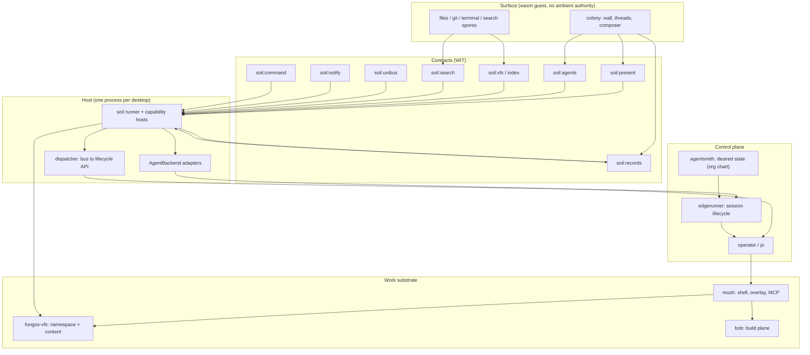
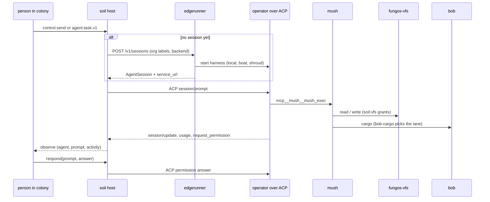
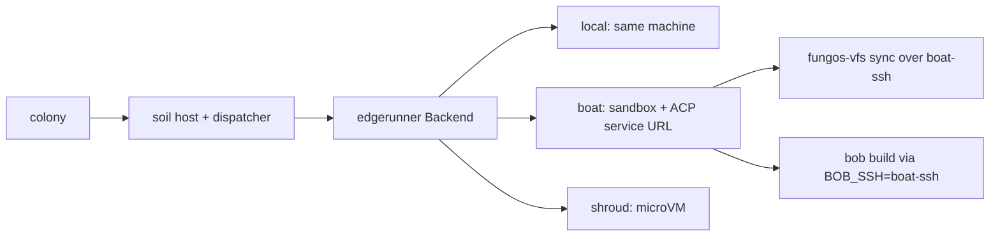

# The operator UI

Status: **map, 2026-11-15.** Colony is becoming the operator surface — the thing
a person opens instead of Delta. This note fixes what that means, which layer
owns each fact, what already exists, and the order to close the gaps. It is a
map, not a claim: the numbers under [Performance](#performance) are budgets to
measure, not results.

## The short answer

Colony today is the *attention* third of an operator UI: agents at a glance, the
one question that needs a person, the press that answers it. Delta is the other
two: a **thread store** (what was said) and a **composer** (what next), with a
transcript between them. Replacing Delta is not a bigger wall. It is adding the
thread surface and pointing the composer at sessions we own.

The substrate is already chosen: `soil:agents` for live sessions, `soil:records`
for durable state, `fungos-vfs` for project content and worktrees, `mush` for
the shell those agents run in, `bob` for where builds run. Colony never gets a
socket, a process, or a credential. It asks its host.

> **Naming:** *Operator* (capital O) is a harness. The *operator* (lowercase) is
the person using the machine. This note says "operator surface" for the person's
UI, and names the harness explicitly when it means the ACP agent.

## Three planes

The split is the one the rest of the ecosystem already uses:

| Plane | Owns | Does not own |
|---|---|---|
| **Surface** (`colony` and the other Spores) | layout, pixels, input, which question is in front | processes, sockets, credentials, session lifecycles |
| **Contracts** (`wit/soil-*.wit`) | the shapes a surface may ask for | policy, storage, transport |
| **Host** (`crates/soil`) | grants, capability implementations, the agent adapters, the one bus, the one store handle | product decisions, agent orchestration |
| **Control** (agentsmith, edgerunner) | desired agent identity, session create/stop/attach | pixels, transcripts as a UI concern |
| **Work** (mush, fungos-vfs, bob) | the namespace, content identity, shell execution, build placement | the UI |

One sentence per boundary:

- Colony **asks**; the host **grants**. A surface that can answer a question
  cannot spawn a process (the rule behind `soil:agents` control having exactly
  `respond`, `send`, `interrupt`).
- Agentsmith **wants**; edgerunner **acts**. The org chart is desired state;
  sessions are incarnations. Colony only ever sees observed state.
- Mush **runs**; the VFS **remembers**. A build's output is overlay garbage, not
  a version; a source edit is a content id.

## One turn, end to end

The important half is the return path. Delta's approvals and questions are
modal in the app and never reach a record stream (`colony:docs/delta-acp.md`),
so a Delta session can only ever look *working*. Owning the session over ACP is
what makes `needs-you` real.

## Who owns which fact

One writer per fact. If a fact appears in two rows, the row that says "derived"
can be rebuilt and the other cannot.

| Fact | Owner | Carrier | Today |
|---|---|---|---|
| Live agent identity, phase, goal, activity, prompts, usage | harness adapter | `soil:agents` | contract + fixture; Operator/Pi adapters next |
| Desired agent identity (role, project, reports-to, spawn spec) | agentsmith | org-chart records | design; reconciler not built |
| Session incarnation (id, run, status, service URL) | edgerunner | `POST /v1/sessions`, `/stream`, ACP proxy | local/docker/shroud backends exist; boat is next |
| Conversation (thread metadata, messages, comments) | **us** | `soil:records` book | missing: schema + host grant |
| Project content (files, blobs, versions) | fungos-vfs | content id + namespace | exists; not yet the runner's `--vfs-root` default |
| Worktrees (per-thread checkout, branch, dirty state) | fungos-vfs + git | VFS namespace per worktree | primitives exist; no thread binding |
| Transcript of a live session | harness, through adapter | `soil:agents.transcript` | paged contract; Operator adapter next |
| Transcript of a stored thread | us | records change feed | missing |
| Shell execution facts (command, exit, stdout) | mush | activity rows via adapter | mush exists; not an adapter yet |
| Build placement and reuse | bob | changeset + artifact store | exists; surfaces nothing to the UI yet |
| Identity of the person | principal | `soil:principal` | host grant exists |
| Notifications | notify host | `soil:notify` + `soil:unibus` | host crate exists; not linked into the runner |
| Search hits | search host | `soil:search` (VFS + records + git + graph) | `soil::search_host`, linked in the runner and granted with `--search`; colony does not import it yet |
| Settings (models, MCP, themes) | host | records book + host config | missing contract; themes are Spore-local today |

### The thread contract, deliberately small

A thread does **not** need a new WIT package in v1. It is:

- a records collection (`threads`, `messages`, `thread-members`) with schema tags,
  a change feed and sync — the properties `soil:records` already has;
- a VFS prefix for its worktrees (`Thread 1 worktree -> checkout on Neo` in
  [desktops](desktop.md));
- a set of content-id references for attachments and diffs.

The schema *is* the contract for now. A `soil:threads` interface only earns its
place when a second host needs to implement it; until then it would be a second
way to say `soil:records` with fewer capabilities.

## Delta parity, one row per promise

`today` means "what the tree can do", not "what the contract allows".

### Read

| Promise | Today | Owner | Gap / next slice |
|---|---|---|---|
| List threads, group by project | `delta thread list` through `delta-acp`; no thread rail in colony | adapter now, records later | thread rail + `soil:records` schema (S1) |
| Open a thread and read it | `focus` view has a feed; rows clip mid-sentence | records / `observe.transcript` | transcript rows with wrapping, paging, tool blocks (S1) |
| Search all threads and files | `soil::search_host` composes VFS index, records, git, graph and marbles; linked in the runner and granted with `--search` | search host | colony imports `soil:search` and draws the rail (S2) |
| `@` file mentions | search host has a mention resolver; colony has no composer | search host | composer mention picker (S2) |
| Tool calls, diffs, images in the transcript | Delta adapter projects `tool_call`/`tool_call_update`; colony renders text only | records / adapter | one `tool` row renderer shared by live and stored transcripts (S3) |

### Write

| Promise | Today | Owner | Gap / next slice |
|---|---|---|---|
| Send a message to an agent | `soil:agents/control.send` exists; no ACP adapter to carry it | host adapter | `AcpAgents` (Operator first) + composer (S1) |
| Approve / answer a question | contract + popup + fixture work; Delta cannot raise prompts | host adapter | real prompts arrive with ACP (S1) |
| Interrupt a turn | contract exists; delta-acp maps `session/cancel` | adapter | ACP cancel for operator (S1) |
| Fork / rewind a thread | not in `soil:agents` by design | harness | compose from records + session fork; not v1 |
| Attach files | VFS content ids; no composer | records + VFS | drop into VFS, store the id (S3) |

### Work

| Promise | Today | Owner | Gap / next slice |
|---|---|---|---|
| Worktrees per thread | fungos-vfs worktree primitives; no binding | VFS | thread -> worktree prefix, checkout status (S3) |
| Diff view | `spores/git`, `spores/files` exist as separate spores | VFS + git | one diff pane in the thread view (S3) |
| Commit / merge / PR | not in colony; delta-acp has no control | edgerunner / host | separate authority; wire only when a session API exists |
| Terminal | `soil:terminal-screen` is linked in the runner; `spores/terminal-gpui` renders it | terminal host | embed as a pane, backed by a mush session (S4) |
| Run a command | `soil:command` registry + mush MCP exist; runner links neither | command host / mush | command palette over installed wasm commands (S4) |

### Environment

| Promise | Today | Owner | Gap / next slice |
|---|---|---|---|
| Local session | edgerunner `LocalBackend` | edgerunner | dispatcher on the bus (S1) |
| Remote sandbox (boat) | `Backend` seam exists; boat backend is next | edgerunner | boat backend + ACP service URL |
| Remote build | bob changesets + `BOB_SSH="contrib/boat-ssh <id>"` | bob | surface build activity, share the sandbox with the session |
| Usage / context meter | `soil:agents/usage`; Delta exposes none | adapter | real numbers from Operator; hidden when zero |

### Notifications and windows

| Promise | Today | Owner | Gap / next slice |
|---|---|---|---|
| Popup over other apps | `agent.prompt.v1` + `view=popup` works in-process | unibus | `soil:notify` host wiring for OS-level popups (S4) |
| Many windows, one desktop | one window per process | host | `HashMap<WindowId, Surface>`; one engine, bus, store (S4) |

### Collaboration

| Promise | Today | Owner | Gap |
|---|---|---|---|
| Shared threads, comments, participants | none | records sync + principal | design after the local store exists; do not fake it |
| Share links | none | host | later; a link is a capability, not a URL |

## Performance

### What the architecture already avoids

- **No webview, no DOM, no JS.** Colony is a wasm component drawing through
  GPUI into its own texture. There is no browser process, no JS heap, no layout
  engine between a keystroke and a repaint.
- **No IPC per interaction.** In the one-process plan the UI, the SQLite index,
  the records store and the agent backend are in one host; a keystroke is a
  wasm call, not a socket round trip.
- **No replay to open a thread.** The Delta adapter reads a JSONL stream and
  replays up to `DELTA_ACP_REPLAY` items before `live`. A records cursor reads
  one page.
- **No polling for state on the wire.** `observe.subscribe` is a change stream
  the guest drains on its own tick; the wall redraws when a fact changes, and
  `motion=still` schedules no idle redraws at all.

### What the current path still pays

- **One finished-frame copy per present.** The guest is not rendering on the
  CPU: colony creates a real wgpu device through `wasi:webgpu` and draws with
  `WgpuContext::from_offscreen`, so text, shapes and the ambient wash are
  GPU-side. Presentation then reads the finished texture back to RGBA for the
  presenter ([`host.rs`](../crates/soil/src/webgpu/host.rs)): at 860x1360 that
  is ~4.7 MB, once per frame produced, and nothing at all when the surface is
  still. A zero-copy handoff (host-owned `wgpu` 30 device + texture lease, the
  direction in [gpu-spores](gpu-spores.md)) would remove that copy; measure it
  before treating it as the top win, because the render itself is already on
  the device.
- **Wasm layout and paint.** GPUI in the guest is fast, but it is still a wasm
  call per layout pass. Text-heavy transcripts are the workload to measure;
  a 60-row list should not become a 60-frame animation.
- **Cold compile.** A new Spore build is Cranelift work. The component cache and
  prewarm path exist ([`runtime.rs`](../crates/soil/src/webgpu/runtime.rs));
  installers and the launcher must keep using them.

### Budgets to measure

These are targets for a benchmark harness, not claims about today.

| Metric | Target | Why it matters |
|---|---|---|
| Warm launch to first frame | <= 400 ms | a daily driver is opened dozens of times |
| Cold launch to first frame (cache miss) | <= 1.5 s, compile off the interaction path | first open after an update |
| Open a stored thread (1000 messages) | <= 100 ms to first screenful | the Delta pain point |
| Keystroke to visible glyph | <= 16 ms at 60 Hz | typing is the product |
| Scroll a transcript | 60 fps, no full re-layout per row | long tool outputs |
| Search (10k files + 100k records) | <= 100 ms to first page | `@` and global search |
| Idle CPU with `motion=still` | ~0% | a wall on a desk should not spin a fan |
| One desktop, many windows | one engine, one store, one bus | no per-window caches |

### Measurement plan

1. A `colony-bench` host harness that records: component deserialize time, first
   present, input-to-present latency (queue an event, timestamp the frame),
   transcript page time, and peak RSS. Run it headless in CI like the frame
   captures.
2. Compare against Delta on the same machine with an honest script: launch to
   first thread, open a 1000-message thread, search, type. Publish the script,
   not a screenshot.
3. Build the harness with bob on the fleet so a benchmark run does not compete
   with the UI it measures.

## Agents all the way down

One contract, several adapters, composed once in the host:

| Adapter | Speaks | State | Direction |
|---|---|---|---|
| `FixtureAgents` | scripted cast | none | prove the ABI |
| `AcpAgents` (`soil::acp`) | ACP over stdio | session id / command | observe + control; Operator first, Pi second |
| `DeltaAgents` | Delta CLI through `delta-acp` | thread id | the ACP adapter with `--acp-cmd delta-acp`; observe + interrupt, **no prompts** |
| `SessionAgents` | edgerunner `/v1/sessions` | org labels | roster and lifecycle facts |
| `PmAgents` | agentsmith org records | project subtree | desired state, read-only |
| `BuildActivity` | bob events | changeset | not an agent: decorates its owner's activity |

What is missing in code:

- ~~**The dispatcher**~~ — landed as `soil::dispatch` (the loop) plus
  `soil::edgerunner` (the client): `agent.task.v1` becomes `POST /v1/sessions`,
  and the created session is announced as `agent.session.v1` so every adapter
  re-lists. A host without `--edgerunner` answers `agent.task.failed.v1` instead
  of dropping the task. What is still missing is org labels on the create and
  the `SessionAgents` roster below.
- **`SessionAgents`** — edgerunner already carries the facts (session id, status,
  run, service URL, labels); the adapter maps labels to `Agent.id` so identity
  survives restarts.
- **`PmAgents`** — the Agentsmith org chart is still design; it reads desired
  state, never session internals.

Order: dispatcher + `SessionAgents` (start and adopt sessions) -> `PmAgents`
(org chart) -> boat backend (remote) -> Pi adapter.

Mush and bob are **not agents** and must not appear as rows. A build or a shell
command is an activity line on the agent that asked for it; the roster stays a
roster of things that can be given a goal and can ask a question.

## Mush and the VFS are the substrate discount

Why these two are load-bearing for a Delta replacement rather than nice extras:

- **The namespace is content-addressed.** Every write is a `ContentId`; a diff,
  an attachment and a thread's worktree all speak the same identity. The VFS
  is a SQLite namespace plus a blob store, so a file read is local and a
  version is free.
- **Worktrees are a first-class operation.** A thread's worktree is a VFS
  namespace plus a git checkout, not a copy of the world. `fungos-vfs` already
  carries worktree primitives and sync; the UI needs a binding, not a new
  storage layer.
- **Sync is pull-based and transport-neutral** (ssh, QUIC, `boat-ssh`). The same
  VFS reaches a laptop, a server and a boat sandbox without a separate content
  plane.
- **Mush is the only place a shell runs.** A host program sees an overlay, not
  the VFS; build output is discarded in both directions; the allowlist is one
  policy. Colony embedding a terminal is therefore a *view over a mush session*,
  never a PTY the Spore owns.
- **Mush knows bob.** `cargo` in a host command is `bob-cargo`; the overlay
  joins `SCCACHE_BASEDIRS`; `BOB_REMOTE_SESSION` makes repeat builds reuse the
  remote target. A UI that wants a build button needs to call this path, not
  spawn cargo itself.

Concretely, the operator surface should have **one VFS root per desktop**, one
mush daemon per root, and a worktree prefix per thread. That matches
[desktops](desktop.md) and keeps the "one worker per daemon" limit honest.

## Environments: local, boat, agora

The constraints we are designing against, from
`colony:docs/dispatch.md` (which records the boat research of 2026-11-12):

- **Operator first, Pi second.** Operator's ACP fits a hosted HTTP URL;
  `pi-shim` is raw line-JSON over TLS and needs the sandbox address or a
  `boat forward` tunnel.
- **No boat API key inside a sandbox.** The key deletes every sandbox on the
  account and the agent has arbitrary `bash`; dispatch credentials stay on the
  control plane.
- **Auto-stop only moves on a boat agent prompt.** Long builds are cut off;
  extend explicitly, never `--no-auto-stop`.
- **Guest to control plane rides the mesh** (`.myc`, application-service
  leases), with a poller as the named degraded mode.
- **Stop is a snapshot, not a checkpoint.** Disk survives, memory does not.

The new piece this map adds: an agent environment, a build environment and a
VFS sync target should be **the same sandbox**. `boat-ssh` is already a bob
transport and a `FUNGOS_VFS_SSH` carrier, so an edgerunner-provided sandbox id
can be handed to both. One environment, three clients, and the build is
**offloaded into it** — bob ships the tree to the sandbox and runs the build
there, so the agent's edit, the build and the VFS sync never leave the
environment. That is the shape, not a later optimization.

## How close is it?

Status words: **wired** (a Spore can use it today), **built** (code exists,
not connected to the runner), **design** (no code path yet).

| Edge | State | Evidence / break |
|---|---|---|
| colony -> host: present, input, cursor, clipboard | **wired** | `canvas-winit` and the `soil-webgpu` capture both present frames |
| colony -> host: agents observe/control | **wired against the fixture** | `--agents demo`; the window passes `NoAgents`, so it draws the empty state |
| colony -> host: unibus (notices, popup) | **wired** | `agent.prompt.v1` capture + seeded popup |
| colony -> host: records (threads) | **design** | colony imports only present/agents/unibus; no thread schema |
| colony -> host: search | **linked, not imported** | the runner links `soil:search` + `mentions` and grants them with `--search`; colony does not import them yet |
| colony -> host: notify / command | **optional / built, not linked** | the popup covers in-process notices, so `soil:notify` is not on the critical path; `soil-command` is still unlinked |
| host -> agents: ACP / Delta | **wired** | `--agents acp|all`; `CompositeAgents` merges the sources; 37 real Delta threads render through `delta-acp` |
| host -> dispatcher -> edgerunner | **wired (first cut)** | `soil::dispatch` + `soil::edgerunner` (`--edgerunner URL`) post `CreateAgentSessionRequest`; a seeded `agent.task.v1` reached a stub service, and the refusal path publishes `agent.task.failed.v1` |
| edgerunner -> operator / pi | **wired** | `LocalBackend` argv, `CreateAgentSessionRequest{agent, runner, operator, labels}`, ACP proxy with prompt/permission/update |
| agentsmith -> edgerunner | **design** | org chart and reconciler not built |
| operator -> mush | **config** | Operator supports HTTP MCP (`docs/mush-operator.md`); not in a seed config |
| operator -> bob | **config via mush** | builds offload only when the shell path is mush, not the built-in bash tool |
| mush -> vfs | **wired** | `mush --root`; VFS grants |
| mush -> bob | **wired** | `bob-cargo` in host commands |
| host -> vfs | **wired but ungranted** | `VfsHost` is linked; canvas-winit grants `--vfs-root` only |
| one process, many surfaces | **design** | one window per process |

### The shortest path to the diagram running

The agent half is one adapter, one composite, one dispatcher, and two flags:

The agent half now attaches a real harness: `--agents acp --acp-cmd delta-acp`
renders 37 Delta threads through `soil::acp` and `CompositeAgents`. What is left
for it:

1. ~~**Dispatcher**~~ — reads `agent.task.v1` and posts to `/v1/sessions`
   (`soil::dispatch`, `soil::edgerunner`, `--edgerunner URL`); the session is
   announced on the bus and the adapter re-lists. Org labels on the create are
   still to come.
2. **`SessionAgents`** — map edgerunner's session labels to `Agent.id`, so a
   restart keeps the same row.
3. **Seed config** — the operator session gets the mush MCP endpoint and a VFS
   root, so its tools run on the substrate instead of the host's bash.

With 1-2, colony shows a real Operator session, prompts it, answers a
permission request, and interrupts it. That is the agent half of S1. The thread
half (records schema + rail/transcript/composer) is what turns the wall into a
Delta replacement rather than a nicer dashboard, and it is the larger piece.

Estimate: the agent half is one focused slice; the full diagram is S1-S4,
because search/notify linking, the thread UI, and the one-process/window work
are independent of each other.

## Roadmap

Each slice is end-to-end and leaves the tree usable.

### S1 — one thread, one session (the Delta third)

- Records schema: `threads`, `messages`, `thread-members`; the desktop root
  wired through the runner's existing `soil:records` grant; change feed into
  the UI.
- Colony: rail (projects -> threads) + transcript pane + composer; phone layout
  collapses to rail-only, >= ~620 px is side-by-side.
- ACP and the composite roster are wired (`--agents acp|all`): send, answer and
  interrupt a real session; prompts raise the popup.
- Dispatcher: `agent.task.v1` -> edgerunner `POST /v1/sessions` (landed, first
  cut: `soil::dispatch`, `soil::edgerunner`).

**Acceptance:** open a thread, send a prompt, see streaming transcript, answer a
permission request from the popup, interrupt the turn. No Delta in the loop for
the new session.

### S2 — find things

- Import `soil:search` in colony (the runner already links and grants it);
  search rail + `@` mention picker.
- Skip `soil:notify` for now: the in-process popup and `soil:unibus` cover the
  notice, and an OS notification is a host capability that can land later.

**Acceptance:** one query returns files, records and spored commands; `@`
suggests from the same grant.

### S3 — work in the thread

- Thread -> worktree binding; checkout status; diff pane over `spores/git`.
- Tool-call rendering (shell, diff, files) shared by live and stored transcripts.

**Acceptance:** open a thread, see its branch and dirty files, read a diff, leave
a comment in records.

### S4 — one process, many surfaces

- `HashMap<WindowId, Surface>`: one engine, one bus, one agent backend, one
  store. `--surface 420x300:view=popup` opens the popup from the wall process.
- Terminal pane over a mush session; command palette over `soil:command`.

**Acceptance:** wall + popup + terminal, one process, idle CPU near zero.

### S5 — Delta as one adapter, then not at all

- Import stored Delta threads through the CLI adapter into records (one-way,
  fidelity documented).
- Keep `DeltaAgents` for live Delta sessions during the transition; stop
  shipping it when Operator covers the work.

**Acceptance:** the same thread list after import; old transcripts readable; no
Delta process required for new work.

### S6 — collaboration

- Records sync + principals for shared threads; comments as records; a share is
  a capability grant, not a public URL.

**Acceptance:** two principals see one thread through their own desktops.

## Decisions to lock

1. **Threads are records; files are the VFS.** Conversation state has one writer
   (`soil:records`), content has one identity (`fungos-vfs`). Do not put
   transcripts in the VFS or blobs in records.
2. **`soil:agents` stays observed state.** Desired state is agentsmith; lifecycle
   is edgerunner. No spawn authority in the surface.
3. **One lifecycle authority.** Even local sessions go through edgerunner, so
   there is one place that creates, stops and adopts a session.
4. **One host process per desktop.** Windows are surfaces, not processes; the
   bus, the engine and the store are per desktop.
5. **One search engine.** `soil:search` composes the existing indexes; do not
   build a thread-only index beside it.
6. **Delta is an adapter, not the store.** The durable path is records we own;
   the CLI projection is a bridge with known limits.

## Open questions

- **Delta import fidelity.** The adapter projects messages and tool calls, but
  attachments, images and some tool payloads may not round-trip. Decide what a
  lossy import is allowed to drop before S5.
- **Usage and cost.** Operator can report context and tokens; Delta exposes
  none. The UI must hide zeros rather than invent a meter.
- **Model choice.** Choosing a model is an authority separate from answering;
  it belongs in the dispatcher/session spec, not the composer.
- **Boat facts still to confirm with the research thread:** GPU availability
  per sandbox, persistent disk guarantees, image build story, teardown and
  cost, and whether a sandbox can serve ACP without the mesh tunnel.
- **Collaboration boundary.** Shared threads need a principal model before a UI
  affordance; do not ship a share button that only works on one machine.
